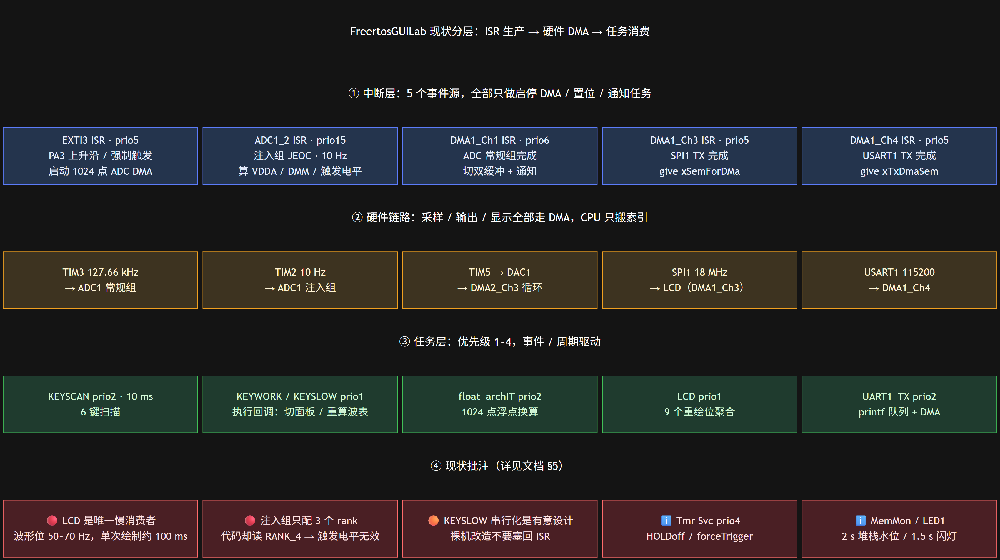
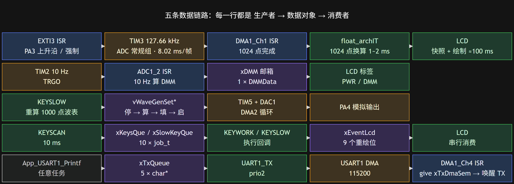
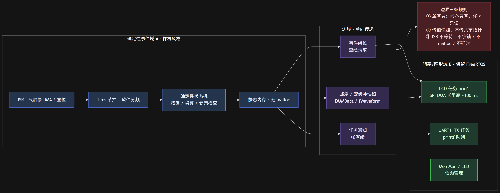

# 裸机改造评估：FreertosGUILab 该不该从 FreeRTOS 改成裸机

> 对象：`FreertosGUILab`（STM32F103RCT6，72 MHz，256 KB Flash，48 KB RAM）
> 代码基线：`main @ b9de91e`
> 参考：`C:\flushbonading\electronicControl` 的裸机分支与 M2 通信框架文档
> 方法：先看事件源、任务、IPC、时序和资源账，再判断"裸机是否合适"，最后给出可落地的混合方案
> 日期：2026-11-20

---

## 0. 结论先行

| 方案 | 结论 | 一句话理由 |
|---|---|---|
| 把主线直接改成纯裸机 | **不建议** | 这不是控制链工程，而是 GUI + DMA 工程；LCD 单次绘制约 100 ms，裸机主循环会被它占满，实时性收益接近 0，输入延迟和维护风险反而上升 |
| 新建分支做纯裸机"对照实验" | **合适** | 学习/面试价值高，能讲清楚 RTOS 到底替你做了什么；但要限定功能、独立分支、不合并回主线 |
| 推荐落地：混合架构 | **最合适** | 保留 RTOS 承载 LCD/UART 等长阻塞；把采样、按键、状态机做成"裸机风格"的单写者事件核；先静态化，再 ISR 瘦身 |

三组关键数字：

1. **6 个并发源**：EXTI3、ADC 注入完成、ADC 常规 DMA 完成、SPI DMA 完成、UART DMA 完成、10 ms 按键扫描；其中 LCD 一个消费者要串行处理 9 种重绘。
2. **1 次 LCD 绘制**：全屏 `240×320×2 = 153.6 KB`，SPI1 18 MHz 下限 `68 ms`；代码注释和实测变量按 `~100 ms` 计。按键扫描周期只有 `10 ms`，比一次绘制小一个数量级。
3. **资源账**：Flash `99,952 B`（38.1%），RAM `44,588 B`（90.7%）；FreeRTOS 内核 text `30,099 B`、bss `15,089 B`（其中 13,312 B 是堆）。资源收益是真的，但"全静态化"可先拿走约 5 KB 闲置堆，纯裸机相对全静态只再省约 8–9 KB RAM。

一句话判断：

> **如果你要的是"少一个内核、省 25–30 KB Flash 和约 14 KB RAM"，裸机值得做；如果你要的是"更好的实时性/更稳的 GUI"，裸机不解决问题，混合才对。**

什么情况下纯裸机反而合适：

- 你能接受 LCD 绘制期间按键延迟接近一次绘制（约 100 ms），或者愿意在 `PrvSendData` 的 DMA 等待里轮询；
- 功能已经冻结，不再加 FFT、SD 卡、网络、文件系统这类新并发；
- 你愿意自己维护 1 ms 节拍、超时、软件定时器和看门狗。

只要有一条不满足，混合方案更稳。

---

## 1. 现状架构：它到底是什么类型的工程

### 1.1 一句话

这是一个**硬件 DMA 驱动的 GUI 示波器/信号源**：采样、DAC 输出、LCD、串口全部 DMA；ISR 只负责"启停/置位/通知"，8 个应用任务负责消费（加上 Timer/Idle 共 10 个任务）；唯一的慢消费者是 LCD。

它和控制类工程（例如 `electronicControl` 的 TIM4 1 ms 控制环）不是同一类问题：

- 控制类工程：**周期短、计算轻、要求确定性** → 裸机 ISR + 主循环很自然。
- 本项目：**周期松、单次绘制极长、并发源多** → RTOS 的价值是"长阻塞时还能跑别的"，不是"算得更快"。

> 注意：本工程没有 1 kHz 级硬实时控制环。后文的"确定性事件域"指的是 ISR + 1 ms 节拍 + 状态机这种**可预测执行风格**，不是"错过就会出事故"的硬实时。

### 1.2 分层总览



四层职责：

- **中断层**：EXTI3 启动 1024 点 ADC DMA；ADC 注入完成算 DMM；三个 DMA 完成中断分别切双缓冲、给 SPI/UART 信号量。
- **硬件链路**：TIM3 触发 ADC 常规组（127.66 kHz），TIM2 触发注入组（10 Hz），TIM5 触发 DAC，SPI1 推 LCD，USART1 走 DMA。
- **任务层**：按键扫描/回调、浮点换算、LCD 重绘、串口打印、内存监控、LED、软件定时器。
- **批注**：LCD 是唯一慢消费者；ADC 注入组只配了 3 个 rank，但代码读了 `RANK_4`；KEYSLOW 的串行化是有意设计。

### 1.3 五条数据链路



> 波形链路的第一段是"EXTI3 启动 ADC DMA + TIM3 提供采样节拍"，不是"EXTI3 触发 TIM3"；图中箭头表示协作关系。

| 链路 | 触发/周期 | 数据对象 | 消费者 | 关键时间 |
|---|---|---|---|---|
| 波形采集 | EXTI3 / 强制触发 | `fRawBuffer[2][1024]` → `fWaveform[2][1024]` → `fDrawBuffer[1024]` | `float_archIT` → LCD | 一帧 8.02 ms；换算约 1–2 ms；绘制约 100 ms |
| 万用表 | TIM2 10 Hz | `xDMM` 邮箱（1 × `DMMData`） | LCD 标签 | 10 Hz，计算在 ADC ISR 里 |
| 信号发生器 | 按键事件 | `usWaveTable[1000]` | TIM5 + DAC + DMA2 | 按键回调毫秒级；DAC 硬件循环 |
| 按键 | KEYSCAN 10 ms | `xKeysQue` / `xSlowKeyQue`（10 × `job_t`） | KEYWORK / KEYSLOW → 事件组 → LCD | 扫描 10 ms；回调毫秒级 |
| 串口打印 | 任意任务 | `xTxQueue`（5 × `char*`）→ DMA | UART1_TX | 115200 bps；DMA 完成给信号量 |

### 1.4 任务表

| 任务 | 优先级 | 栈（字/字节） | 周期/唤醒 | 阻塞点 |
|---|---:|---:|---|---|
| `vKeyWOrksScan`（KEYSCAN） | 2 | 128 / 512 B | `vTaskDelay(10)` | 只有延时，无对象等待 |
| `vKeyWorkerTask`（KEYWORK） | 1 | 128 / 512 B | `xQueueReceive(portMAX_DELAY)` | 等公共按键队列 |
| `vKeySlowTask`（KEYSLOW） | 1 | 128 / 512 B | `xQueueReceive(portMAX_DELAY)` | 等慢按键队列；回调内 `xTimerChangePeriod` 最多阻塞 100 ms |
| `vled1Task` | 1 | 128 / 512 B | 1.5 s | `vTaskDelay` |
| `vLCDTask` | 1 | 256 / 1024 B | `xEventGroupWaitBits(portMAX_DELAY)` | 每次 SPI DMA 完成等二值信号量，`portMAX_DELAY` |
| `vFloating_arithmeticPro`（float_archIT） | 2 | 128 / 512 B | 任务通知 | 等 ADC 帧通知；换算 1–2 ms |
| `vUSART1_TxGateKeeperTask`（UART1_TX） | 2 | 256 / 1024 B | `xQueueReceive(portMAX_DELAY)` | 等打印队列；等 UART DMA 信号量 |
| `prvMemoryMonitorTask`（MemMon） | 1 | 256 / 1024 B | 2 s | `App_USART1_Printf` 可能阻塞在满队列 |
| Timer Svc | 4 | 128 / 512 B | 软件定时器 | HOLDoff / forceTrigger |
| Idle | 0 | 128 / 512 B | 空闲 | 无 Hook |

任务栈合计约 `6,656 B`，另有 TCB、队列、信号量、定时器等约 `1.6 KB`，堆内实际使用约 `8.3 KB`，`13,312 B` 的堆里约 `5 KB` 从未使用。

### 1.5 通信原语

| 对象 | 类型 | 生产者 | 消费者 | 设计要点 |
|---|---|---|---|---|
| `xKeysQue` | 队列 10 × `job_t` | KEYSCAN | KEYWORK | 公共按键，快回调 |
| `xSlowKeyQue` | 队列 10 × `job_t` | KEYSCAN | KEYSLOW | 慢回调串行化，避免堵公共队列 |
| `xEventLcd` | 事件组 9 bit | ADC ISR、float、按键回调 | LCD | `pdTRUE` 清除；多生产者 → 单消费者 |
| `xDMM` | 邮箱 1 × `DMMData` | ADC 注入 ISR | LCD 标签 | 覆盖写，永远拿最新值 |
| `xSemForDMa` | 二值信号量 | SPI DMA 完成 ISR | LCD | 每次分块传输同步一次 |
| `xTxQueue` | 队列 5 × `char*` | 任意任务 | UART1_TX | `pvPortMalloc` 申请，任务释放 |
| `xTxDmaSem` | 二值信号量 | UART DMA 完成 ISR | UART1_TX | 串口发送同步 |
| `ucWriteIdx/ucReadyIdx/ucShowIdx` | volatile 单字节 | ADC ISR / float | float / LCD | 单写者 + 单字节原子发布 |
| `fVddaNow` | volatile float | ADC ISR | float | 32 位对齐，M3 上单次读写原子 |

**没有互斥量**，而且这个工程确实不需要：所有跨上下文共享的数据都满足"单写者 + 快照/双缓冲"。这是当前设计最值得保留的部分，也是混合架构的边界规则。

### 1.6 和截图里的 M2 框架逐项对照

你发的两张截图是 `electronicControl` 的 M2 通信框架。它的核心思想在本工程里其实已经存在，只是对象换了名字：

| 截图里的对象 | 本工程对应物 | 说明 |
|---|---|---|
| TIM4 1 ms 控制节拍 | TIM2 10 Hz（DMM）、TIM3 127.66 kHz（采样）、TIM6 1 ms（HAL 时基） | 本工程没有 1 ms 业务控制环；TIM6 只给 `HAL_GetTick()` 计时 |
| `ParamChangeQueue` | `xKeysQue` / `xSlowKeyQue` | 按键参数变化走队列；慢回调单独一条队列，避免堵公共队列 |
| `IPC_Send_Param_Change_FromISR` | `xQueueOverwriteFromISR(xDMM)`、`xEventGroupSetBitsFromISR` | ISR 只投递，不执行回调 |
| `IPC_Drain_Param_Change` | 任务侧 `xQueueReceive`、`xEventGroupWaitBits` | 消费者在任务里排空 |
| `TelemetrySnapshot` 邮箱 | `xDMM` 邮箱、`fWaveform` 双缓冲、`fDrawBuffer` 快照 | 单写者 + 快照，读到的永远是完整一帧 |
| `g_imu_temperature` 原子写 | `fVddaNow`、`ucShowIdx` | 32 位 float / 单字节索引，M3 上单次读写原子 |
| `VisionTask` / `PlotTask` / `HealthTask` | `float_archIT` / LCD / `MemMon` | 三个消费者的角色一一对应 |

所以"按 M2 的思路做"并不等于"删掉 RTOS"：**M2 真正有价值的是"ISR 只投递 + 任务消费 + 单写者快照"这套边界规则**，本工程已经用它解决了 DMM 邮箱、波形双缓冲和 LCD 事件组。下一步要补的是把 ADC ISR 里的 DMM 计算也搬出去，以及把堆/任务栈收紧，而不是把整个内核删掉。

---

## 2. 时序与资源账

### 2.1 时间预算

| 项 | 数值 | 依据 |
|---|---:|---|
| SYSCLK / APB2 / APB1 | 72 / 72 / 36 MHz | `SystemClock_Config` |
| TIM2 注入触发 | 10 Hz | PSC=7199，ARR=999 |
| TIM3 常规采样 | 127.66 kHz | PSC=0，ARR=563 |
| 一帧 1024 点 | 8.02 ms | 1024 / 127.66 kHz |
| Hold-Off | 14 ms | `frameUs/1000 + 6`，下限 10 ms |
| 强制触发 | 19 ms | Hold-Off + 5 ms |
| 浮点换算 | 约 1–2 ms | 1024 点、M3 软浮点、每点多次乘除 |
| 按键扫描 | 10 ms | `vTaskDelay(10)` |
| LCD 全屏传输下限 | 68.3 ms | 153,600 B / 18 Mbit/s |
| 波形单次绘制 | 约 100 ms | 代码注释（`waveform_panel.c:36`）；实测看 `g_waveDrawMsMax` |
| 屏幕实际刷新 | 约 5–10 fps | 按 100 ms/次 + 其他面板绘制估算 |
| DMM 刷新 | 10 Hz | ADC 注入中断 |
| UART | 115200 bps | DMA |

### 2.2 资源账

| 项 | 数值 | 占比/说明 |
|---|---:|---|
| Flash | 99,952 B / 262,144 B | 38.1% |
| RAM（data+bss） | 44,588 B / 49,152 B | 90.7%，只剩 4.4 KB |
| FreeRTOS 内核 text | 30,099 B | 来自构建对象统计 |
| FreeRTOS 内核 bss | 15,089 B | 含 `configTOTAL_HEAP_SIZE = 13,312` |
| 任务栈合计 | 约 6,656 B | 10 个任务（含 Idle/Timer） |
| 堆实际使用 | 约 8.3 KB（估算） | 栈 + TCB + 队列/信号量/定时器 |
| 堆闲置 | 约 5 KB（估算） | 全静态化可直接拿回 |

> 说明：`44,588 B` 是链接后的 data+bss，不含 MSP 主栈预留；堆的"实际使用"按任务栈、TCB、队列/信号量/定时器逐项估算，量级足够支撑决策，不作为精确值。

RAM 大头（静态）：

| 缓冲区 | 大小 | 说明 |
|---|---:|---|
| `fRawBuffer[2][1024]` | 4 KB | ADC 原始码值双缓冲 |
| `fWaveform[2][1024]` | 8 KB | 换算后的电压双缓冲 |
| `fDrawBuffer[1024]` | 4 KB | LCD 绘制前的私有快照（因为绘制要 ~100 ms） |
| `usWaveTable[1000]` | 约 2 KB | DAC 波形表 |
| FreeRTOS 堆 | 13.3 KB | 含任务栈、TCB、队列/信号量/定时器 |

这四块应用缓冲就占了约 18 KB；即使改纯裸机，它们也不会消失。裸机能省的是"内核 + 多任务栈 + 堆闲置"，不是这些业务缓冲。

### 2.3 真正的瓶颈

不是 CPU 算不过来，也不是中断太慢，而是：

> **LCD 是唯一的慢消费者。** 波形重绘位约 50–70 Hz 到达（一帧 8 ms，Hold-Off 14 ms），单次绘制按代码注释约 100 ms，事件组里的位会持续积压；LCD 任务几乎永远有活干，屏幕实际约 5–10 fps。

这正好解释了 RTOS 在本工程里的唯一核心价值：**LCD 在等 SPI DMA 时，KEYSCAN（prio2）、float（prio2）、UART（prio2）还能跑。** 把 RTOS 删掉，首先受影响的就是这一点。

---

## 3. 纯裸机改造：逐项会发生什么

| 模块 | 现在 | 纯裸机后 | 风险 |
|---|---|---|---|
| LCD 绘制 | LCD 任务阻塞等 DMA 信号量；其他任务照跑 | 主循环阻塞等 DMA 完成标志；其他工作全停 | **高**：必须在等待循环里轮询按键/换算，等于手写一个调度器 |
| 按键扫描 | 独立任务 10 ms | 1 ms 节拍分频，容易 | 低 |
| 慢按键回调 | KEYSLOW 任务串行执行，不堵公共队列 | 只能放主循环；重算波表 + 重启 DAC 是毫秒级 | 中：会推迟其他主循环工作 |
| 波形换算 | float 任务，任务通知唤醒 | 放主循环或 ISR；放 ISR 会阻塞 1–2 ms | 中：ISR 上界被破坏 |
| DMM | ADC ISR 里算，10 Hz | 可保持不变，或搬主循环 | 低 |
| DAC 输出 | 硬件 DMA 循环，CPU 不参与 | 不变 | 低 |
| UART 打印 | 队列 + DMA 信号量 | 改 volatile 标志 + 轮询/超时 | 低 |
| 内存 | 堆 + 多任务栈 | 单主栈；省约 14 KB RAM、25–30 KB Flash | **收益** |
| 可观测性 | 栈水位、堆水位、任务状态 | 需要自己实现 | 中 |

结论：

- **纯裸机技术上可行**，不是"做不到"。
- 但它会把并发塞进三个地方：ISR、主循环、LCD DMA 等待里的轮询。第三个是隐式调度器，也是最容易出 bug 的地方。
- 如果 LCD 单次 DMA 块很大（比如几十毫秒），按键延迟目标就不成立；这一点必须先测，不能拍脑袋。

### 3.1 先测一个数：LCD 单次 DMA 块时长

`lcd.a` 是预编译库，`send_data_callback` 的调用粒度由库决定；改不了库，就只能测。先在 `PrvSendData` 里加两个调试变量：

```c
volatile uint16_t g_lcdChunkMax;      // 单次 HAL_SPI_Transmit_DMA 的最大 size
volatile uint32_t g_lcdChunkUsMax;    // 单次等待 DMA 完成的最大耗时（DWT 或 HAL_GetTick）
```

判据：

- 最大块 ≤ 5 ms：纯裸机在等待循环里轮询按键，手感可以接受。
- 最大块 5–20 ms：勉强，需要把按键扫描拆到 EXTI 或更高优先级。
- 最大块 > 20 ms：纯裸机主循环的按键延迟会明显变差，应先考虑"分块绘制"或放弃纯裸机。

这个测量成本很低，却能决定纯裸机分支是否值得做。

---

## 4. 三方案对比

| 维度 | 现状 RTOS | 全静态 RTOS | 纯裸机 |
|---|---|---|---|
| Flash | 约 100 KB | 约 100 KB | 约 72–75 KB（省 25–30 KB） |
| RAM | 44.6 KB（90.7%） | 约 39–40 KB（省约 5 KB 闲置堆） | 约 30–32 KB（再省 8–9 KB） |
| LCD 绘制期间按键 | 不受影响（KEYSCAN prio2 > LCD prio1） | 不受影响 | 取决于 DMA 块轮询；可能明显变差 |
| 慢按键回调 | KEYSLOW 串行，隔离 | 同左 | 主循环执行，推迟其他工作 |
| 波形换算 | 独立任务，通知驱动 | 同左 | 主循环/ISR；放 ISR 会阻塞 1–2 ms |
| 代码复杂度 | 中（任务/IPC） | 中 | 高（手写调度、超时、状态机） |
| 可观测性 | 好（栈/堆水位） | 好 | 需自建 |
| 故障隔离 | 好（栈溢出钩子、任务隔离） | 好 | 单栈，一处爆栈全崩 |
| 实时性 | 足够 | 足够 | 略好，但本工程没有硬实时控制环，收益接近 0 |
| 学习/面试价值 | 中 | 中 | 高 |

判据打分（本工程）：

- 并发源 ≥ 4？**是（6 个）** → RTOS 加分。
- 存在长阻塞？**是（LCD ~100 ms）** → RTOS 加分。
- 有 1 kHz 级硬实时控制环？**没有** → 裸机的实时性优势发挥不出来。
- 资源紧张？**RAM 90.7%** → 裸机加分。
- GUI 单消费者串行？**是** → RTOS 加分。

**结论：RTOS 更匹配这个工程的"形状"；裸机的优势主要在资源，不在实时性。**

---

## 5. 推荐方案：混合架构

### 5.1 两条执行域



- **确定性事件域 A（裸机风格）**：ISR 只启停 DMA/置位；1 ms 节拍 + 软件分频；确定性状态机；静态内存；不阻塞、不 malloc、不拿锁。
- **阻塞/图形域 B（保留 FreeRTOS）**：LCD 绘制、UART 打印、MemMon/LED 等长阻塞或低频工作。
- **边界**：事件组位、邮箱、双缓冲快照、任务通知；只传值，不传共享指针。

这里的关键不是"一半任务一半中断"，而是**两种执行风格**：

- 域 A 的代码可以放在一个高优先级任务里跑（仍是 RTOS），也可以放在 `main` 的 `for(;;)` 里跑（纯裸机）。同一套状态机，两种宿主。
- 域 B 的长阻塞工作继续由 RTOS 隔离，不需要为了裸机把 LCD 绘制拆碎。

### 5.2 边界三条规则

1. **单写者**：每个共享对象只有一个写者（ISR 或域 A）；任务只读。
2. **传值快照**：跨域只传结构体/索引/事件位，不传共享可变指针；双缓冲和邮箱都是这个思路。
3. **ISR 不等待**：不拿锁、不 malloc、不延时；ISR 里只做"记录 + 置位 + 通知"。

这三条规则在当前工程里已经基本成立，混合改造不是推倒重来，而是把剩下的违规点收干净。

### 5.3 落地顺序

| 阶段 | 改动 | 风险 | 收益 | 验收 |
|---|---|---|---|---|
| **Stage 0** | 最小静态化（打印静态池 + 缩堆）、修 `RANK_4`、SPI 等待加超时、设计 IWDG 喂狗点（先保持关闭） | 低 | RAM 省约 5 KB；消除 P0 隐患 | 编译通过；RAM < 40 KB；DMM/波形/按键不回退 |
| **Stage 1（已落地）** | ADC 注入 ISR 只读 raw + 序号；`BmCore` 每 10 ms 算 DMM/VDDA/触发电平 | 低 | ISR 从"几十 µs 业务"降到"几 µs"；DMM 与 UI 解耦 | ISR 时长下降；DMM 仍 10 Hz |
| **Stage 2（部分落地）** | `BmCore` 1 ms 节拍 + 10 ms 按键扫描 + 10 Hz DMM + DWT 计时；健康检查/IWDG 待做 | 中 | 合并 KEYSCAN；按键抖动 ≤ 1 ms；ISR/BmCore 耗时可观测 | 波形/按键不回退；栈水位正常 |
| **Stage 3** | 独立 `lab/baremetal` 分支，纯裸机对照 | 高 | 再省 8–9 KB RAM、25–30 KB Flash；面试可讲两套实现 | 见 §6 验收表 |

**建议先做 Stage 0 + Stage 1，再决定要不要 Stage 2。** 很多"必须上裸机"的理由，在 Stage 0 之后会消失一半。

### 5.4 Stage 0 的具体改动

1. **修正第 4 路注入通道 + 硬件比较器触发电平（已实现）**
   - 原问题：`main.c:413-445` 只配置了 rank 1–3（CH9、VREFINT、CH8），`dmm.c:149` 却读 `ADC_INJECTED_RANK_4`；`JDR4` 读到 0，触发电平换算成 -2.5 V，触发线贴底。
   - 参考工程 `demo` 已确认板载硬件：`PA0 = OSC_TRIG_LEVEL`（触发电平电位器），`PA3 = OSC_TRIG`（触发输入）；`demo` 的 `main.c` 也把 `ADC_CHANNEL_0` 配成注入通道并使用 `InjectedNbrOfConversion=4`。所以不需要改板，当前工程只是漏配了 PA0。
   - 已修改 `.ioc`：`InjNumberOfConversion=4`，新增 `ADC1.Channel-4=ADC_CHANNEL_0`（PA0/ADCx_IN0）。PA3 保持原来的 `GPIO_NOPULL` + EXTI 上升沿配置，与 `demo` 一致。
   - 已修改生成代码：`MX_ADC1_Init` 从第一路就把 `InjectedNbrOfConversion` 设为 4，按 rank1~rank4 顺序配置；`HAL_ADC_MspInit` 把 PA0 配成模拟输入。
   - `dmm.c` 读回 rank4 并画触发电平参考线，换算与当前工程的波形通道一致：`raw/4095*VDDA*2 - 2.0`（`demo` 里示波器/触发用 `-2.5`，如果实测读数偏高 0.5 V，两处一起改回 `-2.5`）。
   - 关键：不能只补一个 `RANK_4`。如果生成代码仍按 3 路（JL=2）放置，rank1~3 会占用 JSQ2~JSQ4；直接把 JL 改成 4 会把序列错位成 `CH0/CH9/VREFINT/CH0`，CH8 丢失，DMM 的 JDR1~JDR4 全部对不上。现在的 `.ioc` 和生成代码是 4 路从 rank1 开始配置，JSQ 正确。
   - 注意：本工程的注入顺序是 DMM/VREF/PWR/触发，`demo` 是 PWR/DMM/触发/VREF；两者只是顺序不同，代码与 `.ioc` 配套即可，不要直接照抄 `demo` 的 `jadc.c` rank 读取。

2. **SPI 等待加超时（已实现）**
   - 原问题：`LCD_TASK.c` 忽略 `HAL_SPI_Transmit_DMA` 返回值，然后 `xSemaphoreTake(..., portMAX_DELAY)`；DMA 异常时 LCD 任务永久阻塞。
   - 已修复：启动前清残留信号量；检查 `HAL_SPI_Transmit_DMA` 返回值；等待改为 `pdMS_TO_TICKS(100)`；超时/失败时 `HAL_SPI_Abort(&hspi1)`、清信号量、释放 CS。单字节命令 `HAL_SPI_Transmit` 也加了 10 ms 超时。
   - 这是"裸机/RTOS 都应该修"的可靠性问题，不是架构问题。

3. **静态化 + 去 malloc**
   - 现状：`configTOTAL_HEAP_SIZE = 13312`（`FreeRTOSConfig.h:283`）；`App_USART1_Printf` 每次 `pvPortMalloc`（`app_usart1_dma.c:84`）。
   - 最小改动：把打印改成固定块静态池（例如 8 × 128 B 的环形池），`xQueueSend` 放不下就丢弃并计数；堆降到约 9 KB。
   - 彻底改动：`xTaskCreateStatic` / `xQueueCreateStatic` / `xTimerCreateStatic`，堆降到 0；这一步工作量较大，可以放到 Stage 2。

4. **IWDG**
   - 现状：CubeMX 已配置，但 `main.c:271-273` 注释掉，因为全工程没有喂狗点。
   - 方案：Stage 2 的 `BmCore` 里喂狗，并检查各任务心跳；在此之前保持关闭，不要只打开不喂。

5. **周期任务用 `vTaskDelayUntil`**
   - `keyTask.c:80` 用 `vTaskDelay(10)`，周期是"10 ms + 执行时间"；迁到 `BmCore` 后天然变成 1 ms 分频，抖动更小。

### 5.5 Stage 1 的 ISR 瘦身（已落地）

原实现 `HAL_ADCEx_InjectedConvCpltCallback` 里做了：

- 读 `ADC_INJECTED_RANK_1/2/3/4`；
- 算 VDDA、DMM 电压、量程、触发电平（多次浮点乘除）；
- `xQueueOverwriteFromISR` 写邮箱；
- `xEventGroupSetBitsFromISR` 置重绘位。

10 Hz 下这点负载不算什么，但它违反了"ISR 只做短事"的原则。现在改为：

```c
/* ADC 注入 ISR：只写 raw 快照 + 序号 */
s_dmmRaw[0] = HAL_ADCEx_InjectedGetValue(hadc, ADC_INJECTED_RANK_1);
s_dmmRaw[1] = HAL_ADCEx_InjectedGetValue(hadc, ADC_INJECTED_RANK_2);
s_dmmRaw[2] = HAL_ADCEx_InjectedGetValue(hadc, ADC_INJECTED_RANK_3);
s_dmmRaw[3] = HAL_ADCEx_InjectedGetValue(hadc, ADC_INJECTED_RANK_4);
s_dmmSeq++;
```

`BmCore` 1 ms 任务每 10 ms 调一次 `vDMMProcess()`：用序号判断有没有新帧，算 VDDA/DMM/电源/触发电平，然后 `xQueueOverwrite(xDMM)` + `xEventGroupSetBits(xEventLcd)`。ISR 里不再调用任何 FreeRTOS API，也不做浮点，上界可测。`float_archIT` 仍独立，LCD/UART/MemMon 仍是域 B。

### 5.6 Stage 2：`BmCore` 的形态

`BmCore` 不是"把 FreeRTOS 换掉"，而是"把域 A 的状态机放进一个确定性循环"：

```c
/* 1 ms 节拍：TIM6 回调或 vTaskDelayUntil(1) */
void Bm_Tick(void) {
    g_ms++;
    if ((g_ms % 10u) == 0u)  g_evt |= BM_EVT_KEY_SCAN;
    if (g_dmmSeq != g_dmmSeqSeen) { g_dmmSeqSeen = g_dmmSeq; g_evt |= BM_EVT_DMM; }
    if (g_waveSeq != g_waveSeqSeen) { g_waveSeqSeen = g_waveSeq; g_evt |= BM_EVT_WAVE; }
}

void Bm_Poll(void) {
    if (g_evt & BM_EVT_KEY_SCAN) { g_evt &= ~BM_EVT_KEY_SCAN; KeyScan_Step(); }
    if (g_evt & BM_EVT_DMM)      { g_evt &= ~BM_EVT_DMM;      DMM_Process(); }
    if (g_evt & BM_EVT_WAVE)     { g_evt &= ~BM_EVT_WAVE;     Wave_Convert(); }
    Health_Feed();   /* 心跳检查 + HAL_IWDG_Refresh() */
}
```

两种宿主：

- **RTOS 内**：`BmCore` 任务 prio3，`vTaskDelayUntil(&last, pdMS_TO_TICKS(1))`；`KeyScan_Step` 只负责扫描并入队，慢回调仍由 KEYSLOW 执行。
- **纯裸机**：`main` 的 `for(;;) { Bm_Tick(); Bm_Poll(); Bm_Draw(); }`；`Bm_Draw` 只在 dirty 时绘制，`PrvSendData` 的等待循环调用 `Bm_Poll()`。

同一套 `Bm_Poll`，两种宿主，这就是"混合"的可迁移点。

### 5.7 不要做的事

- **不要把 1000 点波表重算放进 ISR**：`sinf` × 1000 + DAC 重启是毫秒级，直接破坏 ISR 上界。
- **不要为了裸机删掉 KEYSLOW 的串行化**：公共按键和慢按键分队列，是这个工程已经验证过的正确设计。
- **不要在没有测出 LCD 单次 DMA 块时长之前删 RTOS**：你可能把一个 100 ms 的阻塞从"只堵 LCD 任务"变成"堵整个系统"。
- **不要用 `HAL_Delay` 替代 `vTaskDelay`**：HAL 时基在 TIM6 中断里，忙等会浪费 CPU，且可能被更高优先级中断拉长。

---

## 6. 如果要做纯裸机对照分支

> 面试/学习优先做 §6.5 的“域 A + 串口”最小闭环；§6.2–6.4 的 LCD 裸机化成本高，不建议先做。

### 6.1 分支策略

- `hybrid/bm-core`：从 `main` 拉出，做 Stage 0–2，验证通过后可合并。
- `lab/baremetal`：从 `hybrid/bm-core` 拉出（复用 `vBmCoreTick()`），只做对照实验，**不合并**；保留作为面试/博客素材。
- 开始前打 tag：`pre-baremetal`，保证随时可回。

```bash
git switch main
git tag pre-baremetal
git switch -c hybrid/bm-core     # 混合方案
# 或者
git switch -c lab/baremetal      # 纯裸机对照
```

### 6.2 执行模型

```c
int main(void) {
    HAL_Init();
    SystemClock_Config();
    MX_GPIO_Init();
    MX_DMA_Init();
    MX_ADC1_Init();
    MX_TIM2_Init();
    MX_TIM3_Init();
    MX_DAC_Init();
    MX_TIM5_Init();
    MX_USART1_UART_Init();
    MX_SPI1_Init();

    Bm_Init();                 /* 静态池、双缓冲、事件位、DWT 计时 */
    LCD_Init(&lcdInstruct);
    for (;;) {
        Bm_Tick();             /* 1 ms 时基，软件分频 */
        Bm_Poll();             /* 按键扫描 / DMM / 波形换算 / 健康检查 */
        if (Bm_TakeDirty()) {
            LCD_Repaint();     /* 阻塞绘制，但 PrvSendData 内部轮询 Bm_Poll */
        }
    }
}
```

### 6.3 关键改造：把 DMA 等待变成"轮询窗口"

```c
static void PrvSendData(uint8_t *pData, uint16_t size) {
    HAL_GPIO_WritePin(LCD_RS_GPIO_Port, LCD_RS_Pin, GPIO_PIN_SET);
    HAL_GPIO_WritePin(LCD_NSS_GPIO_Port, LCD_NSS_Pin, GPIO_PIN_RESET);

    g_spiDone = 0;
    if (HAL_SPI_Transmit_DMA(&hspi1, pData, size) != HAL_OK) {
        Bm_Error(BM_ERR_SPI);
        return;
    }

    uint32_t t0 = DWT->CYCCNT;
    while (!g_spiDone) {
        Bm_Poll();             /* 关键：在 LCD 等待期间扫描按键/换算/喂狗 */
        if (cycles_to_ms(DWT->CYCCNT - t0) > 100u) {
            HAL_SPI_Abort(&hspi1);
            Bm_Error(BM_ERR_SPI_TIMEOUT);
            break;
        }
    }
    HAL_GPIO_WritePin(LCD_NSS_GPIO_Port, LCD_NSS_Pin, GPIO_PIN_SET);
}
```

这就是纯裸机能否保持手感的核心。它把"阻塞等待"改造成"带轮询的等待"，本质上是一个极简的协作式调度器。

### 6.4 验收指标

| 指标 | 目标 | 测量方法 |
|---|---|---|
| 功能等价 | 6 键 / 5 菜单 / DMM / 波形 / DAC / UART 打印 | 手工回归 |
| LCD 绘制期间按键延迟 | ≤ 50 ms | GPIO 翻转 + 示波器，或 `HAL_GetTick` 打点 |
| 波形刷新 | ≥ 5 fps | `g_wavePeriodMsMax` |
| DMM 刷新 | 10 Hz ± 1 | 计数/串口打点 |
| 最长 ISR | < 20 µs | DWT 或 GPIO 翻转 |
| RAM | ≤ 32 KB | `arm-none-eabi-size` |
| Flash | ≤ 80 KB | `arm-none-eabi-size` |
| 连续运行 | 72 h 无复位/无泄漏 | 串口复位原因 + 内存水位 |

如果"按键延迟 ≤ 50 ms"达不到，说明 LCD 的 DMA 块太大，纯裸机分支应停止，回到混合方案。

### 6.5 时间盒方案：只做“域 A + 串口”最小闭环（面试/学习推荐）

> 目的不是替代产品固件，而是用最小成本证明：同一套 `vBmCoreTick()` 可以脱离 RTOS 跑，并量出差异。完整 LCD 裸机化见 §6.2–6.4，成本高，不建议先做。

**范围**

| 做 | 不做 |
|---|---|
| TIM6/SysTick 1 ms 节拍 | LCD/LCD 任务/GUI 面板 |
| `vBmCoreTick()` 原样复用 | 波形绘制/双缓冲显示 |
| ADC 注入 ISR：raw + seq | KEYWORK/KEYSLOW 回调 |
| `vDMMProcess()` 10 Hz | DAC/信号发生器 UI |
| `vKeyScanStep()` 10 ms | 复杂菜单 |
| UART 打印 DMM/按键事件 | I2C/其他外设 |
| DWT/GPIO 打点 | 动态内存/文件系统 |

**宿主**

```c
/* lab/baremetal/main.c */
volatile uint8_t g_tick1ms;

void TIM6_IRQHandler(void) { g_tick1ms = 1; } // 或 SysTick

int main(void) {
    HAL_Init();
    SystemClock_Config();
    MX_GPIO_Init();
    MX_ADC1_Init();
    MX_TIM2_Init();
    MX_USART1_UART_Init();

    vDMMInit();          // 只保留 ADC 注入 + 静态 raw 快照
    VkeyTotalInit(NULL); // 只建队列/初始化按键

    for (;;) {
        if (g_tick1ms) {
            g_tick1ms = 0;
            vBmCoreTick(); // 和 hybrid 分支同一个函数
        }
        Uart_Poll();       // 或阻塞打印，按最小实现
    }
}
```

**构建**

```powershell
cmake --preset Baremetal
cmake --build --preset Baremetal
```

**指标与对比表**

| 指标 | 当前 hybrid/bm-core | lab/baremetal | 怎么测 |
|---|---:|---:|---|
| Flash | 101,888 B | 57,980 B（构建通过，待烧录） | `arm-none-eabi-size` |
| 静态 RAM | 44,648 B | 9,872 B（构建通过，待烧录） | `arm-none-eabi-size` |
| ADC ISR 耗时 | 待测 | 待测 | DWT / GPIO 翻转 |
| 1 ms tick 抖动 | 待测 | 待测 | GPIO 翻转 + 逻辑分析仪 |
| 按键延迟 | 待测 | 待测 | 按键边沿 GPIO → 扫描/打印 GPIO |
| DMM 10 Hz 抖动 | 待测 | 待测 | 邮箱更新时间戳 |
| 代码复杂度 | 中 | 高（自己写宿主） | 主观评估 |

**验收**

- DMM 数值和 10 Hz 刷新与 hybrid 一致。
- 6 个按键都能被扫描到（可以先只打印键值，不跑 UI 回调）。
- UART 能打印版本行和 DMM/按键事件。
- 无 HardFault、无栈溢出、连续运行稳定。
- 至少拿到 ISR 耗时、按键延迟、RAM/Flash 三组数据。

> 首次构建结果（2026-11-21）：`Baremetal` preset 通过，Flash **57,980 B**、静态 RAM **9,872 B**。目标里仍包含 FreeRTOS/LCD 源码，但链接器 `--gc-sections` 把未引用代码裁掉了；这是“域 A + 串口”最小闭环的实际镜像大小，烧录后还需要验证串口/DMM/按键。

**结论预设**

- 如果 baremetal 的 ISR 延迟/按键延迟没有明显优于 hybrid，说明 RTOS 不是瓶颈，产品继续用 hybrid。
- 如果 baremetal 的 RAM/Flash 明显更低，但代码复杂度和回归风险更高，则把它作为面试/学习素材，不合并。
- 无论结果如何，都把对比表写进报告；这比“感觉裸机更快”有说服力。

**不要做**

- 不要把 LCD/GUI 也搬进裸机循环；那是 §6.2–6.4 的完整方案，成本高、收益低（LCD 仍约 6.5 fps）。
- 不要把 `lab/baremetal` 合并回 `main`。
- 不要为了省 RAM 删掉 hybrid 的边界规则；双缓冲/邮箱/单写者仍然适用。

---

## 7. 顺带发现的现状问题

| 级别 | 问题 | 位置 | 影响 | 建议 |
|---|---|---|---|---|
| **P0（已修复）** | 注入组只配 3 个 rank，却读 `RANK_4` | `Core/Src/main.c:413-457`，`DmmAndGui/dmm.c:149` | `JDR4` 未转换，读到 0 → 触发电平换算成 -2.5 V，触发线贴底/无效 | 参考 `demo` 确认板载 PA0 触发电平电位器 + PA3 触发输入；已在 `.ioc` 补 PA0/ADCx_IN0 为 rank4，生成代码按 4 路重配，见 §5.4 |
| **P0（已修复）** | SPI DMA 等待没有超时 | `LCD/LCD_TASK.c:92-127` | SPI/DMA 异常时 LCD 任务永久阻塞，整屏不再刷新 | 已加返回值检查 + 100 ms 超时 + `HAL_SPI_Abort` + 清信号量 |
| **P1** | RAM 90.7%，堆里约 5 KB 闲置 | `freeRTOS/Inc/FreeRTOSConfig.h:283` | 后续加功能容易爆 RAM | 静态池/静态分配，先省约 5 KB |
| **P1** | IWDG 已配置但未启用 | `Core/Src/main.c:271-273`，`README.md:66` | 跑飞无人兜底；直接打开又会 0.41 s 复位 | 先加喂狗点与心跳检查，再启用 |
| **P1（已修复）** | DMM/VDDA 计算在 ADC ISR | `DmmAndGui/dmm.c`、`Core/Src/bmcore.c` | ISR 业务偏长，违反"ISR 只做短事" | ISR 只存 raw+序号；`BmCore` 每 10 ms 调 `vDMMProcess()` 计算并发布 |
| **P2（已修复）** | KEYSCAN 用 `vTaskDelay(10)` 而非 `vTaskDelayUntil` | `key/keyTask.c`、`Core/Src/bmcore.c` | 扫描周期有执行时间抖动 | KEYSCAN 已合并进 `BmCore` 的 10 ms 分频，扫描在 1 ms 任务里跑 |
| **P2** | 无 CPU 负载统计 | `FreeRTOSConfig.h:367-373` | 无法量化优化收益 | 开 `configGENERATE_RUN_TIME_STATS` 或 DWT 打点 |
| **P2** | 调时基时 `HAL_TIM_Base_Stop` 可能打断在途 DMA | `DmmAndGui/waveFormCapture.c:94-101` | 当前帧可能混合两种采样率，下一帧恢复 | 可接受；必要时等 DMA 完成再改 |

---

## 8. 参考工程给我们的结论

`C:\flushbonading\electronicControl` 是**控制链工程**：TIM4 1 ms 节拍 + 主循环 + ISR 置位，裸机是自然形态；它的文档也明确说"裸机最大的问题不是没有 RTOS，而是 ISR 里做长业务没有上界"。

| 维度 | `electronicControl` | `FreertosGUILab` |
|---|---|---|
| 主时间约束 | 1 ms 控制环 | 10 ms 按键 / 8 ms 采样帧 / ~100 ms 绘制 |
| 最长阻塞 | 短 | LCD 单次绘制约 100 ms |
| 并发源 | 控制 + 通信，数量可控 | 采样、DAC、SPI、UART、按键、GUI，6 个 |
| 裸机适配度 | 高 | 中低 |
| RTOS 的价值 | 并发/隔离，属于"可选增强" | 长阻塞期间保住采样/按键，属于"结构必需" |

把这个结论平移到本项目：

- **M2 的思路可以借鉴**：ISR 只做投递，任务做消费；单写者 + 邮箱/队列；不要在 ISR 里做业务。
- **但不要照搬"删 RTOS"**：`electronicControl` 没有 100 ms 的 LCD 阻塞，本项目有；它没有 9 种重绘位串行消费，本项目有。
- **正确的借鉴方式**是混合：把域 A 做成"控制链风格的确定性状态机"，把域 B 留给 LCD/UART 这些长阻塞。这样既保留了 `electronicControl` 的裸机思维，又不丢本项目已经验证过的 GUI 并发结构。

---

## 附录：关键源码位置

| 内容 | 文件 |
|---|---|
| 任务创建与优先级 | `Core/Src/main.c:289-299` |
| ADC 注入组配置（4 路） | `Core/Src/main.c:413-457` |
| DMM ISR raw 快照 + `vDMMProcess` | `DmmAndGui/dmm.c:142-204` |
| BmCore 1 ms 节拍 | `Core/Src/bmcore.c` |
| 双缓冲/任务通知/触发电平对齐 | `DmmAndGui/waveFormCapture.c:20-30`、`:158-213` |
| 时基与 Hold-Off | `DmmAndGui/waveFormCapture.c:42-59`、`:94-102` |
| LCD 分块发送与信号量 | `LCD/LCD_TASK.c:92-99`、`:194-204` |
| 波形快照与绘制计时 | `DmmAndGui/waveform_panel.c:30-78` |
| 按键扫描（BmCore 10 ms 分频） | `Core/Src/bmcore.c`、`key/keyTask.c:68-76` |
| DWT 计时（ISR/BmCore） | `DmmAndGui/dmm.c`、`Core/Src/bmcore.c`、`Core/Src/memory_monitor.c` |
| 堆与任务栈配置 | `freeRTOS/Inc/FreeRTOSConfig.h:109-115`、`:231`、`:283` |
| IWDG 未启用 | `Core/Src/main.c:271-273` |
| 打印 malloc | `Core/Src/app_usart1_dma.c:68-96` |

> 构建、烧录、串口体检步骤见 `docs/env.md`。
